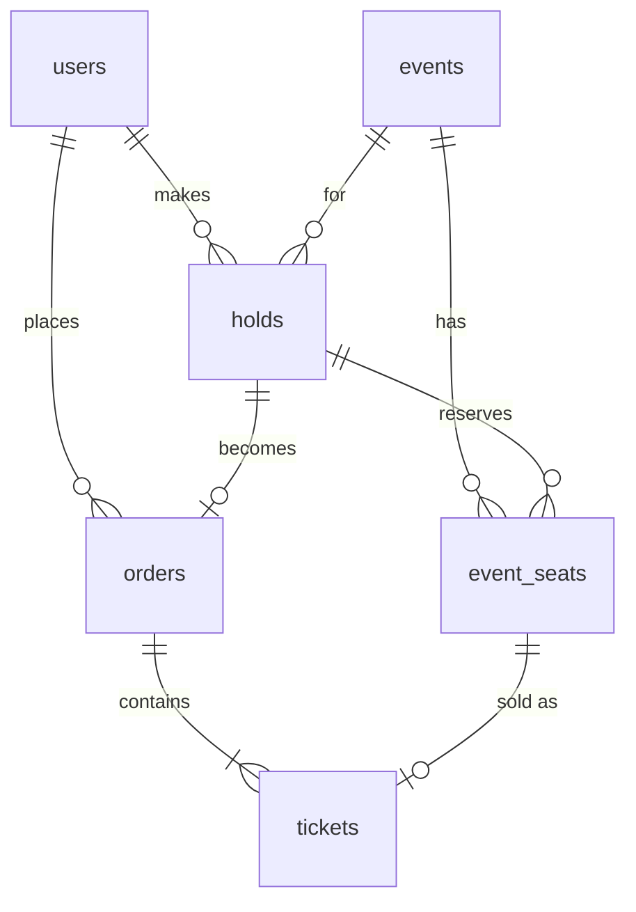
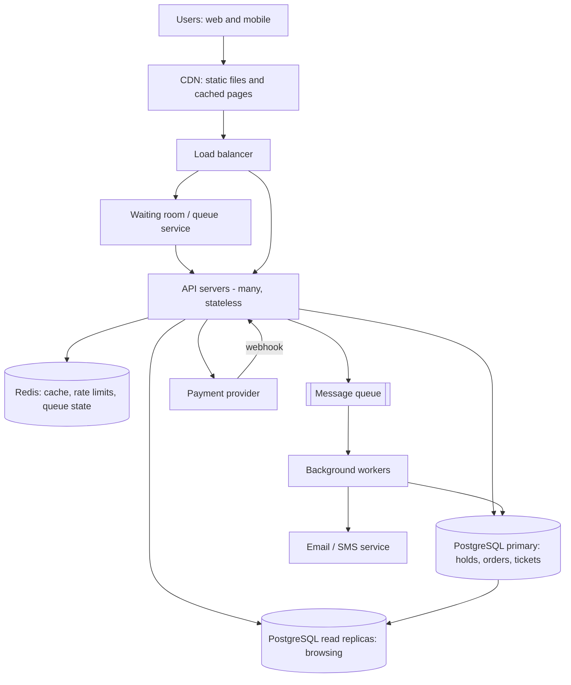

# TicketHub: System Design

TicketHub is a website that sells tickets for concerts and events. The hard part is not the everyday traffic. It is the few minutes when a popular concert goes on sale and far more people than seats arrive at the same moment.

**Given facts**

- 2 million registered users
- 50,000 people visit on a normal day, each viewing 10 pages
- 5,000 tickets sold on a normal day
- Big sale: 200,000 people try to buy 20,000 seats in the first 10 minutes

---

## 1. Requirements

### Functional requirements

1. A user can register, log in and log out.
2. A user can browse and search events (by name, date, city, category).
3. A user can open an event and see its seat map with the status of each seat (available, held, sold) and the price.
4. A user can select up to 4 seats and **hold** them for 5 minutes.
5. A user can pay for held seats and receive tickets.
6. A user can view their tickets and past orders.
7. A user can cancel a hold, and holds expire on their own if unpaid.
8. An admin can create events and set seats, prices and the on-sale time.

### Non-functional requirements

| Quality | Requirement | Why it matters |
|---|---|---|
| **Correctness** (most important) | A seat is never sold to two people. A customer is never charged without getting a ticket, and never charged twice for one order. | Double-selling is the one failure that cannot be fixed with an apology. |
| **Fairness** | During a big sale, people are served roughly first-come, first-served. Nobody can jump the line by refreshing faster or running scripts. A limit per person (4 seats) stops one buyer taking everything. | Fans will leave if the sale feels rigged. |
| **Speed** | Browsing pages load in under 1 second (95th percentile). Seat map loads in under 2 seconds. Placing a hold answers in under 500 ms. | Slow pages in a sale make people refresh, which makes the load worse. |
| **Availability** | 99.9% uptime normally, and the system must stay up during a big sale, even if some features are slowed down on purpose. | A crash during a sale is the worst possible moment. |
| **Scalability** | Handle about 500x normal buying rate for short bursts. | See estimates below. |
| **Security** | Passwords hashed, HTTPS everywhere, card data never stored by us (the payment provider holds it). | Legal and trust reasons. |
| **Durability** | Paid orders are never lost, even if a server crashes. | Money is involved. |

---

## 2. Estimates

### Normal day

- Page views: 50,000 visitors x 10 pages = **500,000 page views/day**
- Average rate: 500,000 / 86,400 s = about **6 requests/s**
- Real traffic is not flat. Assume the busy hour is about 10x the average: about **60 requests/s peak** on a normal day.
- Tickets: 5,000 / 86,400 s = about **0.06 tickets/s** on average. Even at 10x, under 1 purchase per second.

Conclusion: a normal day is tiny. One small database handles it comfortably.

### Big sale (first 10 minutes = 600 seconds)

- Arrivals: 200,000 / 600 s = about **333 users/s**
- Each user loads the seat map and keeps refreshing it. Assume 20 requests each: 200,000 x 20 = 4,000,000 requests / 600 s = about **6,700 requests/s** (mostly reads).
- Seat selection attempts: assume each user tries 3 times: 600,000 / 600 s = about **1,000 hold attempts/s**.
- Seats actually sold: 20,000 / 600 s = about **33 seats/s** (if everything sells in the 10 minutes).
- Competition: 200,000 people / 20,000 seats = **10 people for every seat**. Nine out of ten will be told "sorry, taken".

### Comparison

| Measure | Normal day | Big sale | Ratio |
|---|---|---|---|
| Visitors per second | ~0.6 (50,000 / 86,400) | ~333 | ~570x |
| Requests per second | ~6 avg / ~60 busy hour | ~6,700 | ~1,100x vs average, ~110x vs busy hour |
| Tickets sold per second | ~0.06 | ~33 | ~570x |
| Duration | all day | 10 minutes | |

**What this tells us:** we cannot build for the average day. The design must be built for roughly 100x to 1,000x more load for 10 minutes. The *reads* (seat map) are the biggest volume and can be cached. The *writes* (holds and purchases) are small in number (about 1,000/s) but must be 100% correct, so they go to a database with strong transaction guarantees.

### Storage

- Seats: a large concert has about 20,000 seats. With 1,000 events per year, that is about 20 million seat rows per year, at about 100 bytes each = about 2 GB/year. Small.
- Orders and tickets: 5,000/day x 365 = about 1.8 million tickets/year. Small.
- Conclusion: storage is not the problem. Concurrency is.

---

## 3. API

REST over HTTPS, JSON bodies. All endpoints except browsing need a login token (`Authorization: Bearer <token>`).

| # | Method and path | Purpose | Notes |
|---|---|---|---|
| 1 | `POST /auth/login` | Log in, get a token | Body: `{email, password}` |
| 2 | `GET /events?q=&city=&date=&page=` | Browse and search events | Public, cached for 60 s, paginated |
| 3 | `GET /events/{event_id}` | Event details (name, venue, date, on-sale time, price range) | Public, cached |
| 4 | `GET /events/{event_id}/seats?section=` | View the seat map and each seat's status | Cached for 1-2 s during a sale. Only a hint. |
| 5 | `POST /events/{event_id}/holds` | Hold seats for 5 minutes | Body: `{seat_ids: [..]}` (max 4). Returns `201` with `{hold_id, expires_at, total}` or `409` if any seat is taken |
| 6 | `DELETE /holds/{hold_id}` | Release a hold early | Seats go back to available |
| 7 | `POST /orders` | Pay for a hold | Body: `{hold_id, payment_token}`. Header `Idempotency-Key` required. Returns `201` with the order |
| 8 | `GET /me/tickets` | View my tickets | Returns tickets with event, seat, QR code |
| 9 | `GET /orders/{order_id}` | View one order and its payment status | Only the owner can see it |
| 10 | `POST /payments/webhook` | Payment provider tells us a payment succeeded or failed | Called by provider, signature checked |

**Example: hold request and response**

```http
POST /events/42/holds
Authorization: Bearer abc123
Content-Type: application/json

{ "seat_ids": [9001, 9002] }
```

```json
201 Created
{ "hold_id": 777, "expires_at": "2026-11-01T18:05:00Z", "total": 15000, "currency": "KES" }
```

If a seat is gone:

```json
409 Conflict
{ "error": "SEAT_UNAVAILABLE", "seat_ids": [9002] }
```

Status codes used: 200, 201, 400 (bad input), 401 (not logged in), 403 (not yours), 404, 409 (seat taken or hold expired), 429 (too many requests, or please wait in the queue).

---

## 4. Data model

Database: **PostgreSQL** (relational, real transactions, real constraints).

### Tables

**users**

| Column | Type | Notes |
|---|---|---|
| id | BIGINT PK | |
| email | TEXT | UNIQUE, NOT NULL |
| password_hash | TEXT | NOT NULL |
| name | TEXT | |
| created_at | TIMESTAMPTZ | |

**events**

| Column | Type | Notes |
|---|---|---|
| id | BIGINT PK | |
| name | TEXT | NOT NULL |
| venue | TEXT | |
| city | TEXT | indexed |
| starts_at | TIMESTAMPTZ | indexed |
| on_sale_at | TIMESTAMPTZ | when buying opens |
| status | TEXT | `DRAFT`, `ON_SALE`, `SOLD_OUT`, `CANCELLED` |

**event_seats** (one row per seat per event)

| Column | Type | Notes |
|---|---|---|
| id | BIGINT PK | |
| event_id | BIGINT FK -> events.id | NOT NULL |
| section, row_label, seat_number | TEXT / INT | where the seat is |
| price | INT | in cents / smallest unit |
| status | TEXT | `AVAILABLE`, `HELD`, `SOLD`. CHECK constraint on allowed values |
| held_by | BIGINT FK -> users.id | NULL unless held |
| hold_id | BIGINT FK -> holds.id | NULL unless held |
| held_until | TIMESTAMPTZ | NULL unless held |

Constraints: `UNIQUE (event_id, section, row_label, seat_number)` so a physical seat exists once per event. Index on `(event_id, status)` for the seat map.

**holds**

| Column | Type | Notes |
|---|---|---|
| id | BIGINT PK | |
| user_id | BIGINT FK -> users.id | |
| event_id | BIGINT FK -> events.id | |
| expires_at | TIMESTAMPTZ | now + 5 minutes |
| status | TEXT | `ACTIVE`, `EXPIRED`, `RELEASED`, `CONVERTED` |

**orders**

| Column | Type | Notes |
|---|---|---|
| id | BIGINT PK | |
| user_id | BIGINT FK -> users.id | |
| hold_id | BIGINT FK -> holds.id | UNIQUE (one order per hold) |
| total | INT | |
| status | TEXT | `PENDING`, `PAID`, `FAILED`, `REFUNDED` |
| payment_ref | TEXT | provider's reference |
| idempotency_key | TEXT | UNIQUE per user |
| created_at | TIMESTAMPTZ | |

**tickets** (one row per seat sold)

| Column | Type | Notes |
|---|---|---|
| id | BIGINT PK | |
| order_id | BIGINT FK -> orders.id | |
| event_seat_id | BIGINT FK -> event_seats.id | **UNIQUE** |
| qr_code | TEXT | UNIQUE |

### Relationships

- A **user** has many **holds**, **orders**.
- An **event** has many **event_seats** (about 20,000 for a big concert).
- A **hold** covers 1 to 4 **event_seats** (via `event_seats.hold_id`).
- A **hold** becomes at most one **order** (`orders.hold_id` is UNIQUE).
- An **order** has 1 to 4 **tickets**; each **ticket** points to exactly one **event_seat**, and each event_seat can have at most one ticket (UNIQUE).



---

## 5. How double-booking is prevented

The danger: two people click the same seat at the same moment. A naive program does "read the seat, see it is available, then mark it as sold". Both people read "available" before either writes, so both succeed. This is a **race condition**.

TicketHub uses three layers. The database is the judge; nothing else is trusted.

### Layer 1: one atomic conditional update (the hold)

The check and the change happen in a single SQL statement, so there is no gap between "look" and "write":

```sql
BEGIN;

UPDATE event_seats
SET status = 'HELD', held_by = :user_id, hold_id = :hold_id,
    held_until = now() + interval '5 minutes'
WHERE id = ANY(:seat_ids)
  AND event_id = :event_id
  AND (status = 'AVAILABLE'
       OR (status = 'HELD' AND held_until < now()));   -- expired holds can be taken

-- if rows affected <> number of seats requested: ROLLBACK and return 409
-- otherwise: INSERT the hold row and COMMIT
COMMIT;
```

PostgreSQL locks each row while it is being updated. If two requests hit the same seat, the second one waits until the first commits, then re-checks the `WHERE` condition, sees the seat is now `HELD`, and updates **0 rows**. Exactly one request wins. The loser gets `409`.

Because it is a **transaction**, it is all-or-nothing: if the user asked for 3 seats and only 2 were free, nothing is held and they are told which seat failed. We never leave a person with half an order. Seat ids are always processed in sorted order so two people asking for overlapping seat sets cannot deadlock each other.

### Layer 2: the purchase re-checks the hold (the order)

When the user pays, a second transaction confirms they still own the seats:

```sql
BEGIN;

UPDATE event_seats
SET status = 'SOLD', held_until = NULL
WHERE hold_id = :hold_id AND held_by = :user_id
  AND status = 'HELD' AND held_until > now();
-- rows affected must equal the number of seats in the hold, else ROLLBACK

INSERT INTO orders (...);
INSERT INTO tickets (order_id, event_seat_id, ...) VALUES ...;

COMMIT;
```

If the 5 minutes ran out and someone else took the seat, the update changes 0 rows and the purchase fails cleanly. The payment is refunded or voided.

### Layer 3: a constraint as the final safety net

`tickets.event_seat_id` is **UNIQUE**. Even if there were a bug in our code, or two servers ran the purchase at the same time, the database itself refuses to create a second ticket for the same seat. The constraint turns a silent mistake into a loud error that rolls the transaction back. We do not rely on application code to be perfect.

### Other protections

- **Idempotency key on payment:** if the user double-clicks "Pay" or the network retries, the same `Idempotency-Key` returns the same order instead of creating or charging twice (`UNIQUE (user_id, idempotency_key)`).
- **Cache is never trusted for decisions:** the seat map shown on screen may be 1-2 seconds old (so a user may click a seat that was just taken), but the hold step always goes to the database. A stale screen can cause a "sorry, taken", never a double sale.
- **Expiry job:** a background worker runs every few seconds and frees seats whose hold passed `held_until`, so abandoned carts do not lock seats forever. The `WHERE` clause in Layer 1 also treats expired holds as available, so we do not depend on the worker for correctness.

---

## 6. Architecture



### Components

| Component | What it does | Why it is there |
|---|---|---|
| **CDN** | Serves images, JavaScript, CSS, and cached event pages from servers near the user. | Removes most traffic before it reaches us. Static content costs us almost nothing. |
| **Load balancer** | Spreads requests across API servers, drops unhealthy ones, terminates HTTPS. | Lets us add servers without users noticing. |
| **Waiting room (queue)** | When a big sale opens, users get a random position in a queue and are let into the buying area at a rate the system can handle (for example 1,000 per minute). | Turns a 200,000-person spike into a steady flow. This is the main fairness tool. |
| **API servers** | Run the business logic: browse, hold, pay, tickets. **Stateless** (no data kept on the server), so we can run 2 on a normal day and 30+ for a sale. | Horizontal scaling. |
| **Redis** | Caches event pages and the seat map (1-2 s), stores per-user rate limits and the queue position. | Takes the 6,700 reads/s off the database. |
| **PostgreSQL primary** | The single source of truth for holds, orders, tickets and seat status. All writes go here. | Gives us transactions and constraints, which prevent double-booking. |
| **Read replicas** | Copies of the database used for browsing and search. | Reads scale out and never compete with purchase transactions. |
| **Message queue + workers** | Run slow jobs outside the request: send confirmation emails, generate QR codes, expire old holds, reconcile payments. | Keeps the buying request fast and survives a failed email provider. |
| **Payment provider** | Takes card or mobile money payments and calls our webhook with the result. | We never touch card data. The webhook is a second route to confirm payment if the user's browser closes. |

### How it survives the big sale

1. **Before the sale:** the event page and static files are on the CDN. We scale API servers up ahead of time, because we know the on-sale time (`events.on_sale_at`). Caches are warmed.
2. **Waiting room:** the 200,000 people (333/s) hit the cheap queue service, not the database. They are admitted in small batches. Rate limiting per user and per IP stops bots refreshing 100 times a second.
3. **Seat map reads:** the roughly 6,700 reads/s are answered from Redis and the CDN. The database sees only a few cache refreshes per second.
4. **Holds:** only admitted users (about 1,000 attempts/s at most) reach the primary database. Each hold is a short transaction on a few rows, which PostgreSQL handles easily at this rate. Seats are different rows, so most holds do not block each other.
5. **Payment:** slow work (the payment provider) happens *after* the seats are held, outside any database lock, and the 5-minute hold gives time to pay without blocking anyone.
6. **When seats run out:** the event status flips to `SOLD_OUT`, the seat map and queue show it, and the remaining people in the queue are told straight away instead of waiting.
7. **Failure handling:** if an API server crashes, the load balancer routes around it. If Redis is lost, the seat map falls back to the replicas (slower, but correct). If the payment provider is slow, holds simply expire and seats return to the pool.

---

## 7. Trade-offs

### Trade-off 1: Waiting room (fairness and stability) vs. a simple instant experience

- **Chosen:** admit users from a queue at a controlled rate.
- **Gain:** the database is protected, and nobody wins just because they have a faster connection or a bot.
- **Cost:** real users must wait and feel nervous watching a progress bar; it is extra system to build and test; the queue position is random, so someone who arrived first may be placed behind someone else.
- **Alternative rejected:** let everyone in and "just add more servers". Servers can scale, but 1,000 competing writes on the same 20,000 rows cannot be made unlimited, and the page would crash or time out at the worst moment.

### Trade-off 2: Hold time of 5 minutes (long vs. short)

- **Chosen:** 5 minutes.
- **Gain:** enough time to pay with mobile money or card without panic.
- **Cost:** while a seat is held, nobody else can buy it. If many people abandon their carts, seats look sold out when they are not, and the organiser loses sales for a few minutes. A shorter hold (2 min) sells seats faster but more people fail to finish paying.
- **Mitigation:** release on cancel, and show a countdown timer.

### Trade-off 3: Strong consistency for seats (single primary database) vs. scalability and speed

- **Chosen:** all seat changes go through one PostgreSQL primary with transactions and constraints.
- **Gain:** correctness is simple to reason about and prove: one seat, one winner.
- **Cost:** writes cannot be spread across many databases freely; the primary is a single point of pressure, so we need a failover standby and must keep the write path small.
- **Alternative rejected:** a distributed NoSQL store with eventual consistency would scale writes further but makes double-booking much harder to prevent. At 1,000 writes/s, a good primary is enough, so we pay the consistency cost only where it matters.
- **Related choice:** the seat map is cached for 1-2 seconds, so it can be slightly out of date. We accept "sorry, that seat was just taken" in exchange for being able to serve 6,700 reads/s cheaply.

### Trade-off 4: One application (modular monolith) vs. microservices

- **Chosen:** one codebase with clear modules (events, seats, orders, payments), deployed as many identical copies.
- **Gain:** hold and purchase can share one database transaction, which is exactly what correctness needs. Simpler to build, test and run for a small team.
- **Cost:** the whole app scales together, even though only the buying path is hot. If the team and traffic grow, the seat/booking module could be split out later.

---

## 8. Summary

- Normal traffic is small (about 6 requests/s). The big sale is about 100 to 1,000 times larger for 10 minutes, with 10 buyers per seat.
- Reads are absorbed by the CDN and Redis. Writes are throttled by a waiting room.
- Double-booking is prevented by an atomic conditional update inside a transaction, a re-check at purchase time, and a UNIQUE constraint on `tickets.event_seat_id` as the last line of defence. The database decides, never the cache.